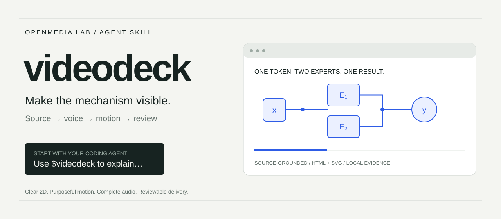
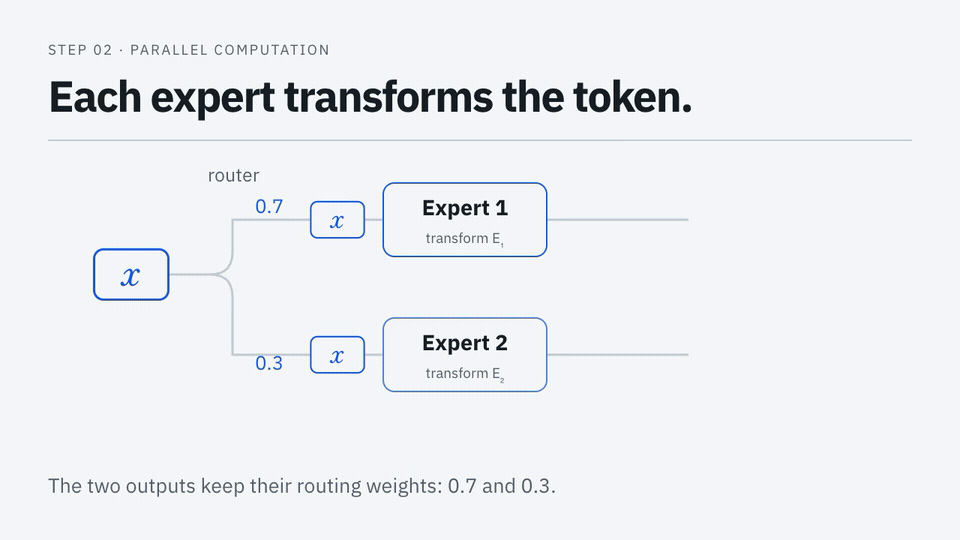

<p align="center">
  
</p>

# videodeck

**让你的编程 Agent 把技术文章做成讲得清楚的视频。**

保留机制、公式与例子，选择声线，设计动态讲解，再审阅真实成片。
兼容 Agent Skills 的宿主可使用：HyperFrames 负责渲染，
[caption-cli](https://github.com/OpenMedia-Lab/caption-cli) 在本地准备审片材料。

[快速开始](#快速开始) · [看实际效果](#看实际效果) · [工作流](docs/workflow.md) · [使用指南](docs/usage.md) · [English](README.md)

[](https://github.com/OpenMedia-Lab/videodeck/actions/workflows/validate.yml)
[](LICENSE)

## 看实际效果



仓库内 [12.4 秒可运行示例](videodeck/assets/example/README.md)的六秒片段。
同一组加权输出移动成公式中的项。示例只有测试音轨连续性的合成音，不是配音样片。
[复现演示](docs/assets/README.md)。

## 快速开始

把内层 skill 目录安装到宿主。以 Codex 为例：

```sh
git clone https://github.com/OpenMedia-Lab/videodeck.git
cd videodeck
mkdir -p "$HOME/.codex/skills"
videodeck_target="$HOME/.codex/skills/videodeck"
test ! -e "$videodeck_target" && test ! -L "$videodeck_target" &&
  ln -s "$PWD/videodeck" "$videodeck_target"
```

已有安装时更新原 checkout。其他兼容宿主使用同一内层 `videodeck/` 目录。
[安装与运行条件](docs/usage.md#install)。

然后把原文和目标交给 Agent：

> 用 $videodeck 把这篇文章做成面向工程师的 90 秒竖屏讲解。
> 保留公式与计算例子，沿用已确认声线和转场，先交付本地视频、封面和字幕供我审阅。

第一次制作时提供原文、受众、平台或画幅。其余会影响结果的缺项，通过真实试听、关键帧
和动态样片对齐，不要求你先掌握设计术语。

## 从原文到成片

| 阶段 | 交付什么 |
| --- | --- |
| 理解 | 有来源的大纲、锁定事实与完整解释线索 |
| 声音 | 试听或复用声线、上下文发音检查、一条完整主音轨 |
| 设计 | 真正排版的数学、清楚的 2D、必要时的局部 3D 与独立封面 |
| 动画 | 按真实声音定时、保留已确认转场、可确定性跳转的组合 |
| 审片 | 真实编码视频、带时间码的画面证据、明确的听审能力边界 |
| 交付 | MP4、封面、字幕、可编辑源文件及审阅记录 |

skill 本身不要求模型 API 或付费视频账号；Agent 宿主与所选配音工具有各自的运行条件。
投稿为可选步骤，使用已确认的最终文案与设置。[完整工作流](docs/workflow.md)。

## 按任务继续

| 我想…… | 从这里开始 |
| --- | --- |
| 制作或修改视频 | [Skill 入口](videodeck/SKILL.md) |
| 不装配音模型，先试试渲染 | [可运行 HyperFrames 示例](videodeck/assets/example/README.md) |
| 保持系列声线和风格 | [项目偏好](docs/usage.md) |
| 本地审阅生成视频 | [caption-cli](https://github.com/OpenMedia-Lab/caption-cli) |
| 审阅后投稿 | [Bilibili](videodeck/references/platforms/bilibili.md) · [小红书](videodeck/references/platforms/xiaohongshu.md) |
| 了解实际验证范围 | [验证记录](docs/validation.md) |

## 参与贡献

提交 [issue](https://github.com/OpenMedia-Lab/videodeck/issues)时附上源材料上下文、预期行为
和最小复现。改动前后运行 `python3 -m unittest discover -s tests -v`。
私人声线、账号状态与源媒体保留在仓库外。

属于 [OpenMedia-Lab](https://github.com/OpenMedia-Lab)，与制作社交图卡的
[postdeck](https://github.com/OpenMedia-Lab/postdeck)配合使用。
[MIT](LICENSE)；外部运行时、字体和源媒体保留各自条款。
