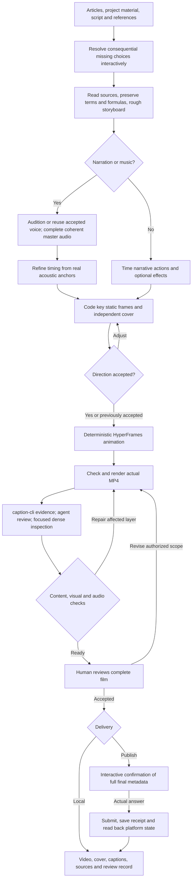

# Production workflow

Repairs return to the earliest bad layer (source, sound, timing, animation or encoding),
not necessarily only to rendering. Present actual audio/frame candidates rather
than asking the user to specify professional design terminology. Routine edits
reuse accepted directions; local previews can be delivered before final acceptance.

The workflow incorporates the reference tutorial
[如何用 agent 做视频](https://xhslink.cn/o/3NjfcrXedKu): rough storyboard, coherent audio,
audio-informed timing, code-first keyframes, then full animation and agent review.
Its full 380.82-second range was examined through 382 sampled images in 32 sheets
and independent local speech transcription, including the ending. This is sampled
visual inspection and transcript verification, not a claim of continuous motion
review or native listening. Tutorial media is not redistributed.

Audio providers are interchangeable. The tutorial separately credits narration
and music providers; those choices do not become dependencies of this skill.
The skill records constraints, decisions and evidence while leaving composition
and motion design open to the agent.
